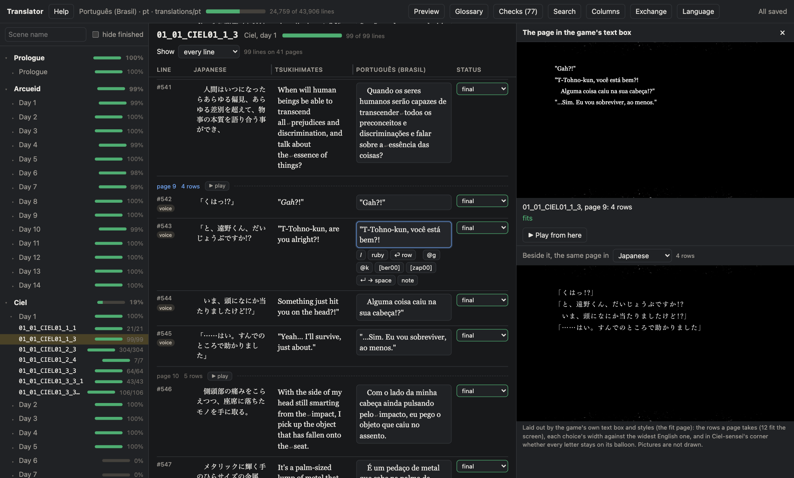

# Tsukihime Translator

The translator tool of the Tsukihime web port ([arcueid.date](https://arcueid.date), [TsukiREbuild](https://github.com/waifwu/TsukiREbuild)) as a Windows app. It runs on top of the game's PC build that you have installed. It reads the game's files and never changes them, and keeps your translation in a folder of your own, usually a git repository of your own.

> **Needs the game.** The translator runs on top of the Tsukihime web port's Windows app ([TsukiREbuild](https://github.com/waifwu/TsukiREbuild)): download it from [arcueid.date](https://arcueid.date) (DOWNLOAD, [Windows](https://arcueid.date/desktop/Tsukihime-win-x64.zip)) and unzip it first. The translator reads the game's own files and does not work without them.

[-2f5fa7?style=for-the-badge)](https://github.com/waifwu/TsukiREbuild-Translator/releases/latest/download/TsukihimeTranslator-win-x64.zip)

The latest version, as a zip. Every version and what changed in it: [Releases](https://github.com/waifwu/TsukiREbuild-Translator/releases).

**Fully compatible with deepLuna.** deepLuna's readable files go in and out through the editor's Exchange panel, with deepLuna's italics codes and its 55-letter rows kept, and a whole deepLuna project imports with `web-dev/tools/exchange.py`.



*The editor over HanabiWorks' Portuguese translation (Ciel, day 1). On the right: the page as the game's own text box lays it out as you type, and the same page in Japanese.*

## Download

1. Have the game (required): the Windows build from [arcueid.date](https://arcueid.date) (DOWNLOAD), unzipped into a folder of its own (`Tsukihime.exe`, with `resources\www` beside it).
2. Download `TsukihimeTranslator-win-x64.zip` (the button above, or the [latest release](https://github.com/waifwu/TsukiREbuild-Translator/releases/latest)), unzip it anywhere (next to the game is fine), and run `Tsukihime Translator.exe`.
   - It is not signed, as the game is not: Windows shows its SmartScreen notice. Choose More info, then Run anyway.
3. It finds the game by itself, or asks where `Tsukihime.exe` is.
4. The first time, it asks for your translation's folder. An empty folder starts a new translation.
5. **Help** in the editor's top bar explains the rest: five steps to a first line, the window, the keys and the marks.

The first time it opens, the app fetches the game's Japanese from arcueid.date (about 57 MB, once; the Windows game itself downloads it only when 日本語 is chosen). The Japanese column, the checks against it and the page shown in Japanese use it. Later starts fetch only what the site has changed, and without the network the copy fetched before is used.

## Updates

Once the editor is open, the app looks at this repository's latest release.

- **When the release has newer tool files** (the editor, its checks, the server), the app downloads them quietly and checks each one. It then asks before restarting the editor with them. "Later" uses them the next time it opens.
- **When the release needs a newer app** (a new Electron or Python, or a change to the app around the tool), the app does not update itself. It offers this releases page instead.
- **Help → Check for updates** looks again at any time. **Help → About** says which version is running.

Your translation folder is never touched by an update. Beyond your computer, the app reaches only GitHub (updates) and arcueid.date (the Japanese).

## What is in it

- `web-dev/translator/`: the editor (scenes, columns, preview in the game's own text box, checks, glossary, translation memory, search, import and export).
- `web-dev/fit/`: the page that lays text out exactly as the game does.
- `web-dev/tools/`: the tool's server (`dev_server.py`), how it reads an installed game (`gamefiles.py`), the line map, the translation folder, the checks and builder (`build_layer.py`), the exchange formats (`exchange.py`), and `translator_manifest.py`, which describes the tool's files for updates.
- `web/server.py`: the game's own local server, which the tool's server builds on.
- `web-dev/translator-app/`: the app (Electron): `main.js`, `updater.js`, `build.sh` and its own README.
- `web-dev/tests/`: the tests, run with `node --test web-dev/tests/*.test.mjs`. They use invented lines only.

No file of the game is in this repository. The tool reads them from the game you have installed.

## Making a release

Push a tag:

```bash
git tag v2026.11.18
git push origin v2026.11.18
```

A second release on the same day: `v2026.11.18-2`.

The workflow (`.github/workflows/release.yml`):

1. runs the tests;
2. builds the Windows app;
3. publishes a release with the app, plus `update.json` and the tool's files, which installed apps update from.

The release is published only once every file is attached.

- **Changing only the tool's files** (`web-dev/translator`, `web-dev/fit`, the tools listed in `web-dev/translator-app/tool-files.json`) reaches installed apps by itself.
- **Changing the app itself** (`main.js`, `updater.js`, Electron, the bundled Python) reaches only people who download the new zip. When the tool comes to need such a change, raise `shell` in `tool-files.json` and `TOOL_SHELL` in `main.js` together. Older apps then point their users to the new download instead of taking an update they cannot run.

Building by hand: `web-dev/translator-app/build.sh` (Windows zip) or `build.sh mac` (to try it on a Mac). See `web-dev/translator-app/README.md`.
